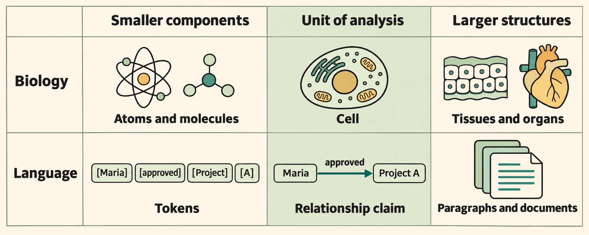
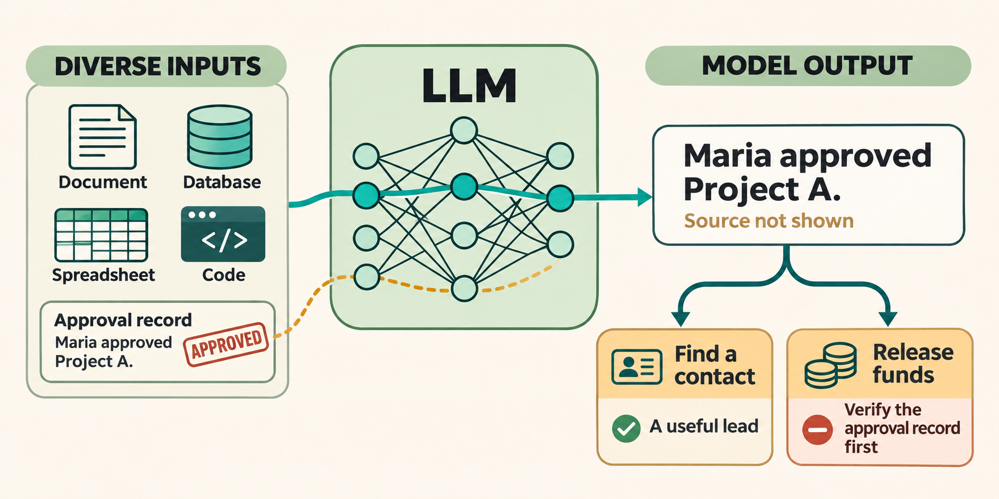
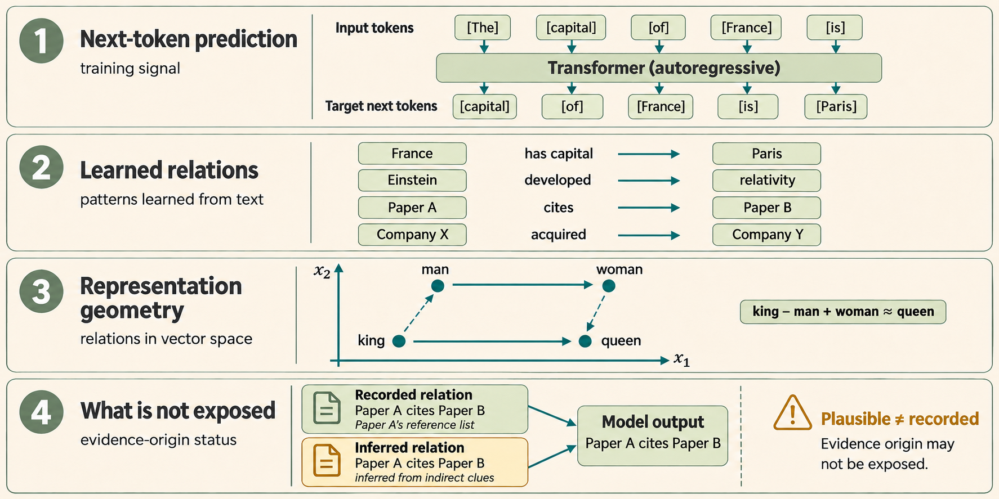
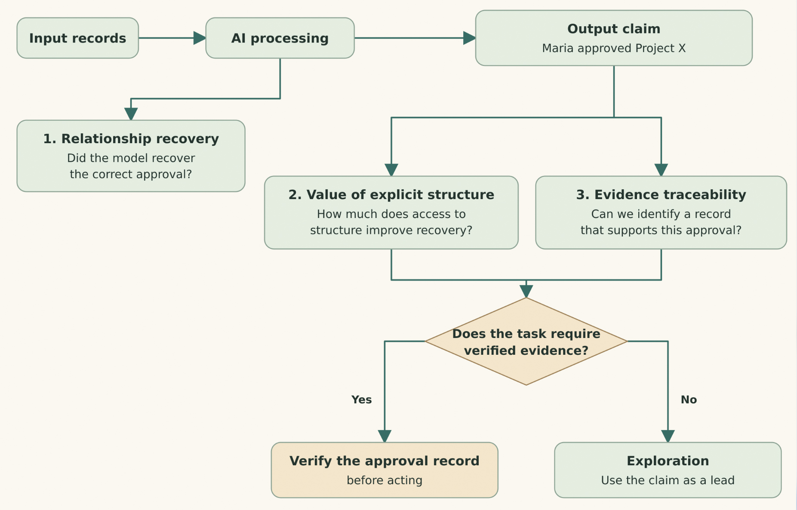

<h1 id="relationships-language-and-trust-in-ai">Relationships, Language, and Trust in AI</h1>

The more capable AI becomes and the fewer mistakes it makes, the more we trust it and rely on it for consequential decisions. But greater accuracy does not, by itself, make the evidence more traceable. A correct answer can still leave unclear whether a relationship was stated in a source record or inferred from learned patterns. As we give AI more responsibility, that distinction matters more. Meaningful oversight requires understanding both whether a claim is right and what supports it.

A relationship tells us how things are connected. Two quantities can vary together, a river can feed a lake, and a person can authorize a decision. Each connection gives us information about the world that a description of either participant alone leaves open. The kind of connection matters. An association describes what varies together. A causal relationship makes a claim about what brings about a change. An approval records a decision by someone acting in a particular role.

We focus on a narrower question in AI. When a system encounters or produces a claim about a specific relationship, what can it recover about the connection and its source? Our unit of analysis is the <strong>relationship claim</strong>, such as <em>Maria approved Project X</em>. We follow claims at this scale across language, structured data, and model outputs. That lets us ask separately whether the system recovered the connection, whether explicit structure helped, and what we can establish about its evidential basis.

<h2 id="choosing-a-scale">Choosing a scale</h2>

In <em>The Hedgehog and the Fox</em>, Isaiah Berlin describes two ways of making sense of the world. The hedgehog sees things through one organizing idea. The fox draws on many experiences and explanations. For our purposes, there is a related question about scale. What can we see between the smallest details and the whole picture? <a href="https://press.princeton.edu/books/paperback/9780691156002/the-hedgehog-and-the-fox">Isaiah Berlin, <em>The Hedgehog and the Fox</em></a>

Biology gives us an example. At the molecular scale, we can ask how a reaction happens. At the scale of a cell, we can ask what that reaction lets the cell do. At the scale of an organ, we can ask how tissues work together. Each scale makes a different question possible.

In language, tokens are the pieces a model processes, and paragraphs and documents provide context. The relationship claim gives us something specific to follow across both. We can find <em>Maria approved Project X</em> in a document, represent it in a graph, or test whether a model recovers it. We can also ask which version she approved and which record establishes that approval. That makes the relationship claim the unit of analysis for this study.

<figure style="margin:24px 0;">
  
  <figcaption style="margin-top:10px;"><strong>Figure 1. Choosing a scale of investigation.</strong> The highlighted column shows an intermediate scale in each domain. The relationship claim is the unit we follow in this study.</figcaption>
</figure>

<h2 id="why-relationships">Why Relationships</h2>
<h3 id="in-language-relationships-build-meaning">In language, relationships build meaning</h3>

The names <em>Maria</em> and <em>Project A</em> tell us who and what we are talking about. The relationship gives each a role. In <em>Maria approved Project A</em>, Maria made the decision and Project A was the subject of it. <em>Maria reviewed Project A</em> names the same person and project but describes a different action. We can also qualify the approval by saying which version it covered or whether it depended on a safety review.

Figure 2 follows that claim from an approval record through a language model. The answer preserves who approved what, while leaving out the source. If we are looking for someone to contact, Maria is a useful lead. If we are deciding whether to release funds, we need to find the approval record and check that it covers the decision at hand.

<figure style="margin:24px 0;">
  
  <figcaption style="margin-top:10px;"><strong>Figure 2. One approval claim, two uses.</strong> The answer can point us to a contact. Releasing funds requires checking the approval record.</figcaption>
</figure>

<h3 id="in-structured-data-relationships-become-queryable">In structured data, relationships become queryable</h3>

When we represent relationships explicitly, a question about their meaning becomes a query over recorded data. We can ask which versions Maria approved, which approvals carried a condition, or which payments depended on an approval that was later revoked.

There are several ways to represent these connections. A relational database can keep an approval table with references to the approver, project version, and decision record. A query can join those tables to retrieve the approvals and their sources. A graph can represent the same approval as an event linked to its participants and record. A graph query can then follow a chain of relationships from a payment through an approval to the version it covers. In either form, we can ask precise questions about the connections the data actually records.

<h3 id="in-ai-relationships-can-be-learned-and-inferred">In AI, relationships can be learned and inferred</h3>

A language model learns by predicting the next token. Along the way, it can learn patterns that help it recognize the same relationship in different wording or infer a connection from clues across passages. Some patterns can be expressed geometrically in vector space, as the Word2Vec example in Figure 3 illustrates.

As Figure 2 shows, the model can tell us who approved the project while leaving out the source. A citation claim works the same way. “Paper A cites Paper B” can come from a reference list or an inference. The wording alone leaves us unable to tell which.

<figure style="margin:24px 0;">
  
  <figcaption style="margin-top:10px;"><strong>Figure 3. How language models learn and express relationships.</strong> The last panel shows how a recorded citation and an inference can lead to the same answer.</figcaption>
</figure>

<h2 id="what-we-measure">What We Measure</h2>

We study the gap from three directions. We first ask what a trained model recovers about a relationship and its recorded origin category. We then ask when explicit graph structure helps distinguish observed links from alternatives. Finally, we test whether a representation can single out a particular recorded connection. Each study has its own data, method, and result.

<figure style="margin:24px 0;">
  
  <figcaption style="margin-top:10px;"><strong>Figure 4. A framework for measuring relationships in AI.</strong> The first two branches concern recovery and the value of explicit structure. The third points toward evidence traceability. Our current test measures one step in that direction, identifying a recorded target among plausible alternatives. The diagram also shows where verification of a supporting record would fit.</figcaption>
</figure>

<h3 id="1-recovering-a-relationship-and-its-origin-category">1. Recovering a relationship and its origin</h3>

Can a language model learn a relationship before it learns where the claim came from? We ran a small training experiment to find out. We trained a model from scratch on fictional claims so we could control exactly what it saw. By testing it at several points during training, we could see when it began to recover the relationships and when it could also identify their recorded source categories.

<h4 id="methods">Methods</h4>

The training text described who received credit, who was offered an opportunity, and who had authority in fictional community clubs. Every claim had an assigned source category, such as a project record or a colleague’s opinion. We varied how often a claim appeared and how often its source was stated. Some claims appeared 32 times and others appeared eight times. In each group, we stated the source either every time or in one out of eight mentions.

At each checkpoint, we asked the model to complete a claim by choosing the club. We then asked it to identify the source category for the claim it had just completed. This gave us two scores: how often it got the relationship right, and how often it got both the relationship and its source category right.

<h4 id="experiments-and-results">Experiments and results</h4>

At 120,000 training tokens, the model correctly recovered <strong>98.6%</strong> of frequent relationships whose source was stated only occasionally. It got <strong>both the relationship and the source category right in 11.1%</strong> of the same 144 trials. For frequent claims whose source was stated every time, joint recovery was <strong>95.1%</strong> at the same checkpoint. With more training, the gap largely closed. By the final checkpoint, joint recovery was at least 98.6% in all four conditions.

<h4 id="interpretation">Interpretation</h4>

In one run, the model correctly identified GardenClub as the club that gave Leon design credit. It attributed the claim to Leon himself, while the corpus attributed it to a project record. That is the distinction the experiment makes visible. A model can learn the relationship before it reliably learns what kind of source the claim came from. Checking the claim itself would still require finding and examining the record.

<h3 id="2-measuring-what-explicit-graph-structure-adds">2. Measuring what explicit graph structure adds</h3>
<h4 id="methods-1">Methods</h4>

One part of this work appeared at SEMANTiCS 2026 in <a href="https://doi.org/10.3233/SSW260017"><em>When Knowledge Graph Relationships Still Matter</em></a>. The paper asks what can be recovered from text and what improves when a representation can also learn from graph structure. In its OpenAlex case study, the same papers offer multiple kinds of connections. Two papers can cite the same references, belong to the same topic, or directly cite one another. The papers and their title and abstract text can stay the same while the relationship under investigation changes.

The study uses cosine similarity to score the same held-out paper pairs in two embedding spaces. The first comes from the text alone. The second uses GraphSAGE to reshape those text features using the observed training links. ROC AUC summarizes how well each representation ranks observed links above sampled non-links. The difference, <strong>ΔAUC = graph AUC − text AUC</strong>, shows which representation performed better under that comparison.

<h4 id="experiments-and-results-1">Experiments and results</h4>

The study repeated the comparison across relation types and publication-year slices. The table shows selected results for the Language Models / Transformers slice.

<table>
<thead>
<tr class="header">
<th>OpenAlex relationship</th>
<th style="text-align: right;">Slice year</th>
<th style="text-align: right;">Text AUC</th>
<th style="text-align: right;">Graph AUC</th>
<th style="text-align: right;">Reported ΔAUC</th>
</tr>
</thead>
<tbody>
<tr class="odd">
<td>Shared references</td>
<td style="text-align: right;">2021</td>
<td style="text-align: right;">0.707</td>
<td style="text-align: right;">0.933</td>
<td style="text-align: right;">+0.225</td>
</tr>
<tr class="even">
<td>Shared references</td>
<td style="text-align: right;">2025</td>
<td style="text-align: right;">0.737</td>
<td style="text-align: right;">0.914</td>
<td style="text-align: right;">+0.176</td>
</tr>
<tr class="odd">
<td>Direct citation</td>
<td style="text-align: right;">2021</td>
<td style="text-align: right;">0.883</td>
<td style="text-align: right;">0.626</td>
<td style="text-align: right;">−0.257</td>
</tr>
<tr class="even">
<td>Shared topic</td>
<td style="text-align: right;">2021</td>
<td style="text-align: right;">0.653</td>
<td style="text-align: right;">1.000</td>
<td style="text-align: right;">+0.347</td>
</tr>
<tr class="odd">
<td>Shared topic</td>
<td style="text-align: right;">2025</td>
<td style="text-align: right;">0.591</td>
<td style="text-align: right;">1.000</td>
<td style="text-align: right;">+0.409</td>
</tr>
</tbody>
</table>

<em>Selected results from the Language Models / Transformers slice. The paper reports gaps from unrounded values. The focused 2025 direct-citation comparison was excluded because the retained graph was sparse.</em>

Shared references showed a graph advantage in both slices. Direct citation favored the text representation in the 2021 comparison. Shared topic was a calibration case because the graph already encoded topic membership. The smaller shared-reference gap in 2025 is a comparison between publication-year slices, with differences in composition and citation maturity. These results concern the evaluated representations and pair task.

This comparison gives us a way to test where explicit graph structure adds predictive value. The direct-citation result describes how the two representations ranked pairs. We can check the citation record to see which paper was actually cited.

<h3 id="3-identifying-the-recorded-connection">3. Identifying the recorded connection</h3>
<h4 id="methods-2">Methods</h4>

In ongoing work, we separate population-level ranking from identification of a particular recorded connection. For each held-out case, we rank one recorded target against 20 eligible challengers. The target is the cited paper in the citation example and the recorded approver in the synthetic example. Strict Top-1 counts a success only when the recorded target outranks every challenger. The strongest-challenger margin measures the score gap between the recorded target and its highest-scoring alternative.

In the synthetic experiment, the scorers rank candidates without access to the supporting approval records. A match can help narrow the search for the relevant record. Verifying the claim requires locating that record and checking what it establishes.

<h4 id="experiments-and-results-2">Experiments and results</h4>

<table>
<thead>
<tr class="header">
<th>Recorded target</th>
<th style="text-align: right;">Text strict Top-1</th>
<th style="text-align: right;">GraphSAGE strict Top-1</th>
</tr>
</thead>
<tbody>
<tr class="odd">
<td>Scientific citation</td>
<td style="text-align: right;">45.79%</td>
<td style="text-align: right;">32.09%</td>
</tr>
<tr class="even">
<td>Synthetic approval, aligned descriptions</td>
<td style="text-align: right;">13.33%</td>
<td style="text-align: right;">9.33%</td>
</tr>
</tbody>
</table>

In the citation illustration, text ranked the recorded paper first more often than GraphSAGE, yet plausible alternatives frequently outranked it. In the synthetic approval illustration, descriptions exposed who could plausibly approve a release, while identifying the recorded approver remained difficult. The two illustrations use different data and protocols.

Low identification tells us the tested representation is a weak route to the recorded connection. Direct access to the original record may be needed. Higher identification would give us a stronger candidate to investigate.

<h2 id="what-we-have-measured-and-what-comes-next">What we have measured and what comes next</h2>

Across the three studies, we measured different properties of a relationship. In controlled training, we found that when attribution was sparse, a model recovered relationships more often than it recovered their origin categories. In OpenAlex, we measured how access to graph structure changed the ranking of candidate pairs for different types of relationships. In a separate experiment, we tested whether a representation could distinguish the exact recorded target from plausible alternatives.

These studies cover the methods we have explored so far. Making relationships queryable opens up other ways to study them. This is part of the appeal of knowledge graphs in AI. We can follow a chain of connections or compare patterns across many entities. We can also query relationships in relational databases, compare them across versions of a dataset, or test how they change when we give a model different evidence. Each approach lets us ask a different kind of question about the connections themselves.

This work has applications in AI risk assessment, AI governance, the review of complaints about AI-assisted decisions, and the design of AI agents. Looking at individual relationships can help us identify which claims need evidence, trace which decisions depend on them, and decide what an agent should verify before it acts.

